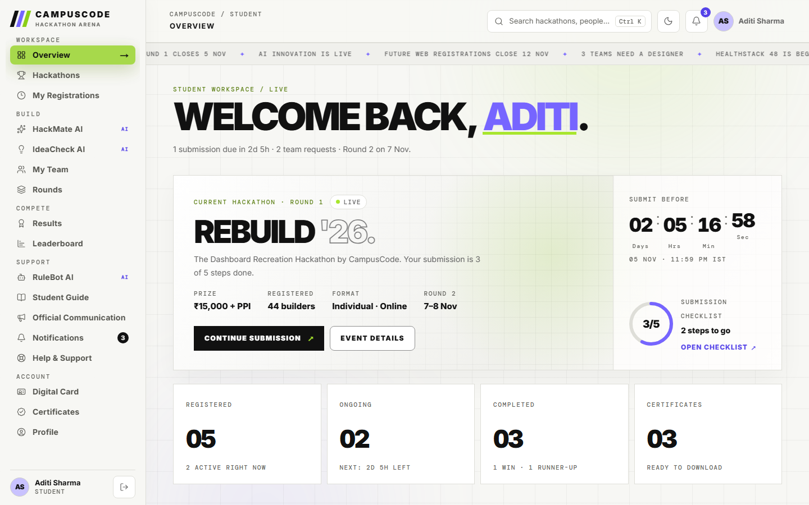
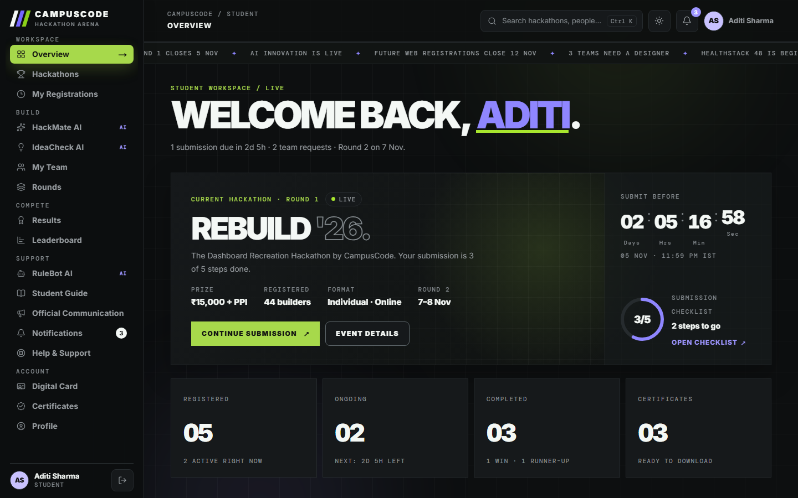
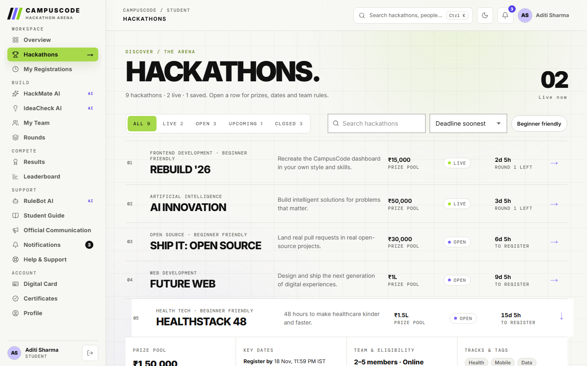
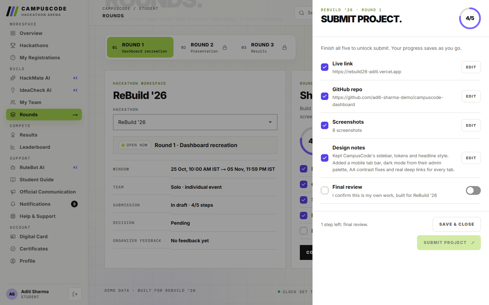
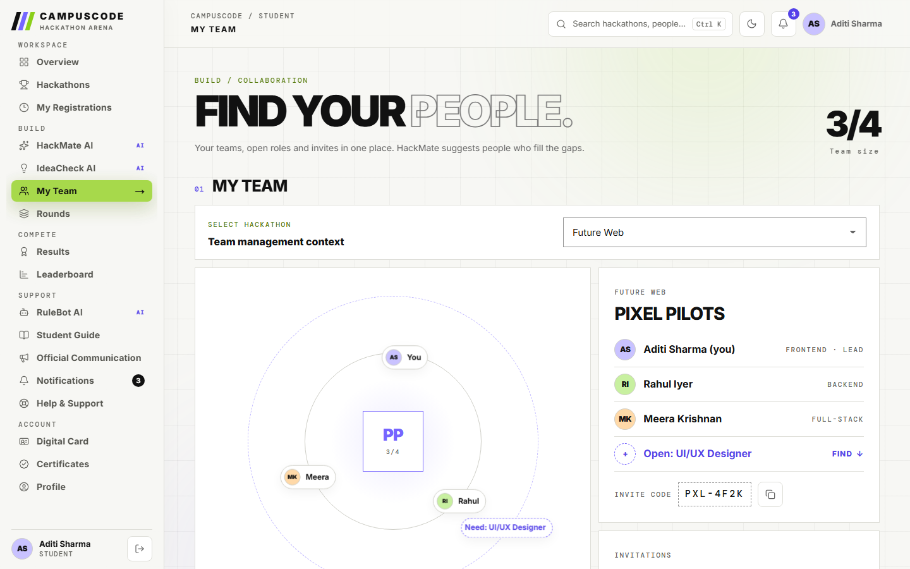
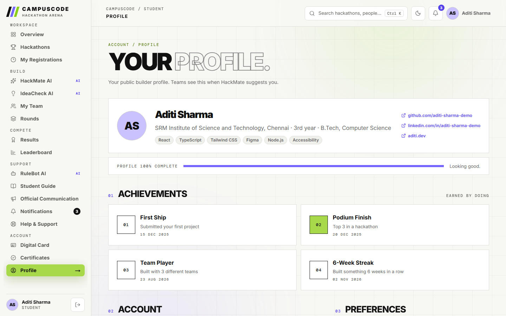
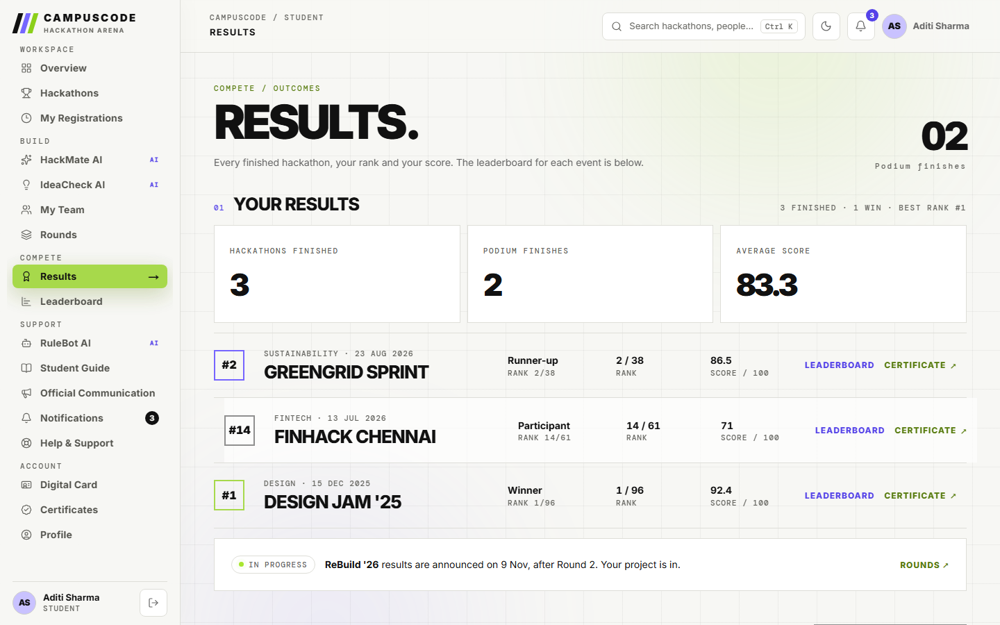
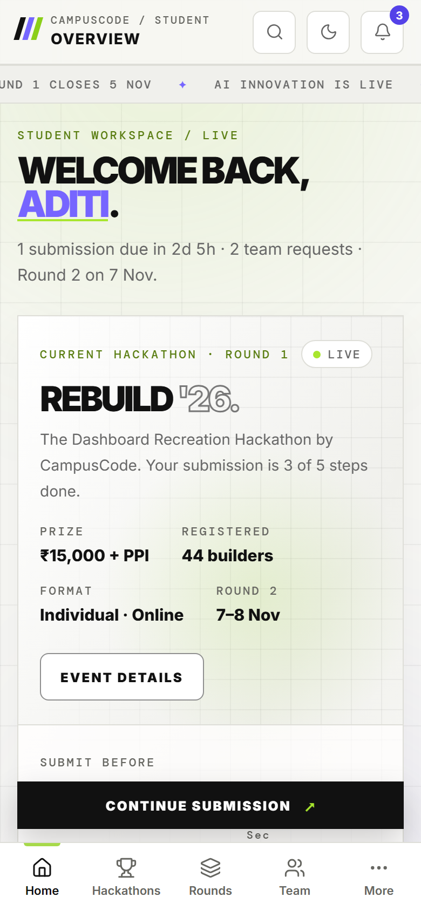
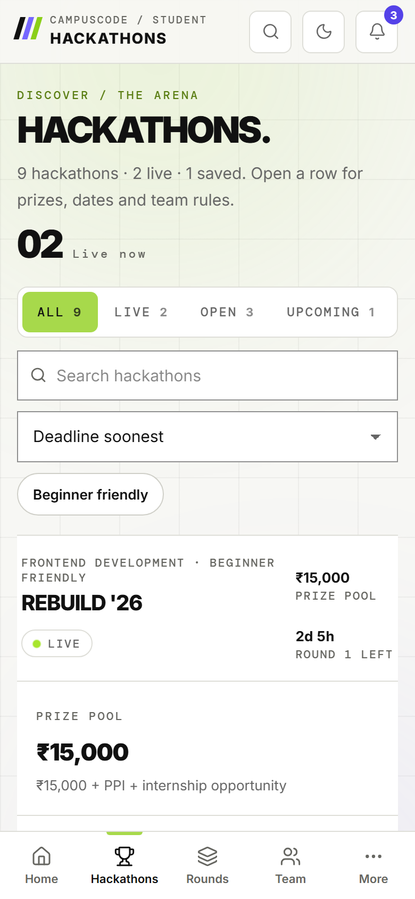
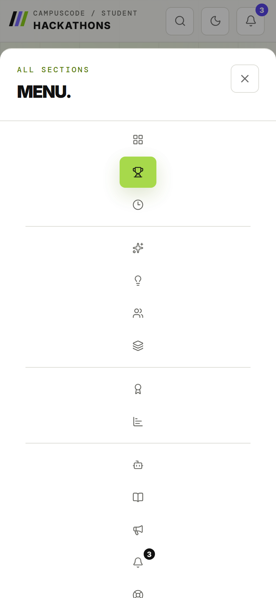

# CampusCode Student Dashboard — ReBuild '26

A mock logged-in student dashboard for **ReBuild '26, the Dashboard Recreation Hackathon by CampusCode**.
It keeps CampusCode's look (tokens, Inter + DM Mono, solid/outline headlines, lime active nav, grid and glows)
and spends the creativity on what a dashboard needs: mobile, dark mode, accessibility, deep links and real flows.

**Live:** _add your Vercel link here_ · Frontend only · All data is mock data (clock set to 3 Nov 2026, IST)



## What's inside

| Section | Tabs | What you can do |
| --- | --- | --- |
| Workspace | Overview, Hackathons, My Registrations | See what needs you now, find and register for events, track each one from Discover to Ship |
| Build | HackMate AI, IdeaCheck AI, My Team, Rounds | Team orbit with open roles, people suggestions, idea rubric, round status and the submission checklist |
| Compete | Results, Leaderboard | Ranks, scores and per-event leaderboards with your row highlighted |
| Support | RuleBot AI, Student Guide, Official Communication, Notifications, Help & Support | Rules Q&A, guide, one inbox for announcements and notifications, support form |
| Account | Digital Card, Certificates, Profile | ID card, printable certificates, editable profile and preferences |

The demo starts mid-story: ReBuild '26 Round 1 is live, the submission is 3 of 5 steps done, and the Future Web team
is 3 of 4 with an open designer slot. Try finishing the submission from **Rounds**.

## Upgrades, each tied to a problem

| Problem | What we did |
| --- | --- |
| Small lime and grey labels were hard to read | Darker "ink" twins of the brand colours; every text pair passes WCAG AA (axe: 0 violations on 15 routes, light + dark, desktop + phone) |
| Mobile layout | Bottom tab bar (Home, Hackathons, Rounds, Team, More), the main action pinned above it, no sideways scroll at 360–412 px |
| No dark mode | Dark theme built from CampusCode's own emerald admin palette; follows the OS, remembers your choice, circular reveal when switching |
| Tabs had no URLs | Every tab has its own link; tabs that share a page (e.g. Leaderboard) open it scrolled to their section; refresh and back work |
| Empty screens | Every list has a real empty, loading and error state that tells you what to do next |
| Submitting was unclear | 5-step checklist with a progress ring, inline validation ("That isn't a GitHub link…"), submit unlocks at 5/5 |
| 17 flat sidebar items | Same labels and order, grouped under Workspace / Build / Compete / Support / Account |
| Deadlines across time zones | All dates stored with +05:30 and shown in IST; countdowns recompute from the clock so they never drift |
| "AI" that might make things up | RuleBot answers only from the official rules and says so when it can't; IdeaCheck and HackMate show the rules behind every score |
| Keyboard users | Visible focus ring, skip link, Ctrl K command palette, Esc closes every dialog, arrow keys in tabs |
| Motion | CSS-first, transform and opacity only, every animation has a reduced-motion version |

## Numbers

| Check | Result |
| --- | --- |
| Lighthouse desktop | Performance 99 · Accessibility 100 · Best practices 100 |
| Lighthouse mobile | Performance 89–98 · Accessibility 100 · LCP ≈ 2.0 s · CLS 0 |
| Initial JS | ≈ 101 KB gzip; every other tab is lazy-loaded |
| Fonts | Inter latin (48 KB) + a 1 KB ₹-only subset instead of the 85 KB latin-ext file |

Contrast (light theme, on `#f7f7f4`):

| Use | Colour | Ratio |
| --- | --- | --- |
| Headlines, body | `#111111` | 17.6 : 1 |
| Secondary text | `#666666` | 5.4 : 1 |
| Labels, timestamps | `#666661` | 5.4 : 1 |
| Small purple text | `#5442e8` | 5.9 : 1 |
| Eyebrow labels (lime twin) | `#587c0f` | 4.5 : 1 |
| Active nav text on lime | `#111` on `#a7d94b` | 11.4 : 1 |

## Stack

- **Vite 8 + React 19 + TypeScript**, **React Router 8** (declarative routes, one lazy chunk per tab)
- **Tailwind CSS 4** for layout utilities; brand tokens and components in plain CSS
- **NumberFlow** (rolling numbers), **Sonner** (toasts), **cmdk** (command palette, lazy), **canvas-confetti** (lazy, once on submit), **lucide-react** (icons)
- No backend, no chart library, no animation library: rings, stepper, heatmap and orbit are hand-built SVG/CSS

## Run it

```bash
npm install
npm run dev       # http://localhost:5173
npm run build     # type-check + production build
```

Deploys to Vercel as a Vite app; `vercel.json` rewrites all routes to `index.html` so deep links work on refresh.
"Reset demo" in the footer restores the starting data.

## Screenshots

| | |
| --- | --- |
|  |  |
|  |  |
|  |  |

<p>
  
  
  
</p>

---

Demo data · Built for ReBuild '26. Not affiliated with any organisation named in the mock data.
